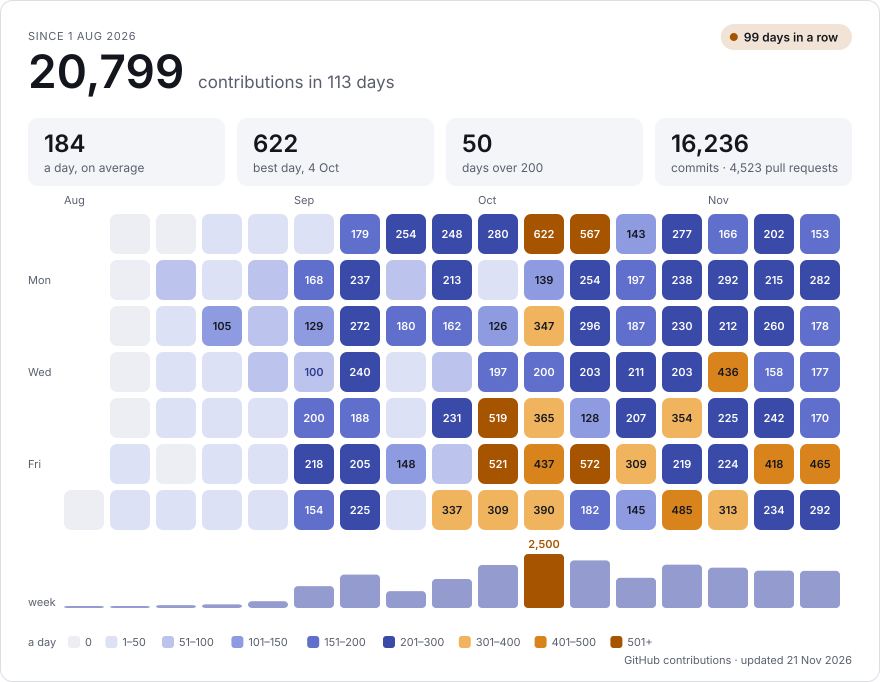

<!-- Generated file. Do not edit by hand. -->

# Ivan Zaitsev

**One builder, a fleet of AI agents, apps people install.**

I design and ship AI-native products for iPhone, Mac, Android and the web from Valencia, Spain, through [Fabrique Futur](https://www.fafutur.com), the studio I co-founded. Agents write most of the code. I decide what gets built and what ships.

[X](https://x.com/ceozaitsev) · [LinkedIn](https://www.linkedin.com/in/zaitsew) · [Fabrique Futur](https://www.fafutur.com) · [Studio on GitHub](https://github.com/Fabrique-Futur)

<picture>
  <source media="(prefers-color-scheme: dark)" srcset="https://raw.githubusercontent.com/zaitsew/zaitsew/main/assets/activity-dark.svg">
  
</picture>

> **26** products · **5** live · **8** beta · **13** building · **14** open source

## Products

Everything I am shipping or building, live first. Beta builds are in TestFlight; want early access? Message me on [X](https://x.com/ceozaitsev).

| Product | What it is | On | Status |
|---|---|---|---|
|  [**Guiri**](https://guiri.fabriquefutur.com) [Web](https://guiri.fabriquefutur.com) | Turns Spanish you meet into phrases you can say tomorrow, then drills them until they stick. | web, iOS, macOS | Live |
| [**Inadviser**](https://inadviser.com) [Web](https://inadviser.com) | Public at inadviser.com: 11 value-for-money boards and 5 benchmark guides with sourced prices, a published method and honest verdicts. | web | Live |
|  [**Loco**](https://apps.apple.com/app/id6809226188?ct=github-profile&mt=8) [App Store](https://apps.apple.com/app/id6809226188?ct=github-profile&mt=8) · [Google Play](https://play.google.com/store/apps/details?id=com.fabriquefutur.loco&referrer=utm_source%3Dgithub%26utm_medium%3Dprofile) · [Web](https://loco.fabriquefutur.com) | Shared plan for your day and trips: flights, stays, to-dos and who is where, for the whole group. | iOS, macOS, Android, web | Live |
| [**Teyla**](https://teyla.dev) [Web](https://teyla.dev) · [Source](https://github.com/zaitsew/teyla) | Operating layer for one person running many AI-built products on one Mac: questions, policy, cost, builds. | macOS, iOS | Live |
|  [**Wine Cave**](https://apps.apple.com/app/id6808361269?ct=github-profile&mt=8) [App Store](https://apps.apple.com/app/id6808361269?ct=github-profile&mt=8) · [Google Play](https://play.google.com/store/apps/details?id=com.fabriquefutur.winecave&referrer=utm_source%3Dgithub%26utm_medium%3Dprofile) | A sommelier for your own cellar: tracks bottles, learns taste from verdicts, picks tonight's wine. | iOS, macOS, Android | Live |
| **Afterglow** | Long-exposure camera for iPhone with Silk, Trails and Freeze effects. | iOS | Beta |
| [**Casa No Pasa**](https://github.com/zaitsew/casa-no-pasa) [Source](https://github.com/zaitsew/casa-no-pasa) | Helps Barcelona renters answer new flat listings first, with a ready reply and a tenant file. | Telegram, web | Beta |
|  **Finca** | A barista for your own coffee: tracks bean bags, freshness, brews and taste. | iOS, macOS | Beta |
|  **Iron U** | Closed-loop Ironman 70.3 coach: writes the plan, pushes it to the watch, reads results, adapts. | iOS, macOS, Android, web, Garmin | Beta |
|  **Lumi** | AI shot director for iPhone: plans the outing, checks each take, cuts the film from footage. | iOS, macOS | Beta |
|  **Orbita** | Your network as four rings: who is going cold, birthdays, promises, and what you owe each person. | iOS, macOS | Beta |
|  **Petit Chef** | Runs a recipe like a workout, and Lonja guides fish and seafood from counter to plate. | iOS | Beta |
| [**Speedyt**](https://github.com/zaitsew/speedyt) [Source](https://github.com/zaitsew/speedyt) | Ad-free, open-source internet speed test for Android TV and Google TV, driven by the remote. | Android TV | Beta |
| **Awind** | An iPhone home for a Garmin watch, in place of the Garmin Connect and Connect IQ apps. | iOS | Building |
| [**Baika**](https://github.com/zaitsew/baika) [Source](https://github.com/zaitsew/baika) | An iPhone storyteller: a story in any style, narrated with an expressive voice and kept in your library. | iOS | Building |
| [**BankJar**](https://github.com/zaitsew/bankjar) [Source](https://github.com/zaitsew/bankjar) | Compares Spanish bank offers by goal, with AI search, open data and an MCP server. | web | Building |
| **Beyond Intelligence** | Weekly, monthly and yearly brief and dashboard on AI and startups. | web | Building |
| [**CasaVPN**](https://github.com/zaitsew/casavpn) [Source](https://github.com/zaitsew/casavpn) | Installer and tooling for a home VLESS + Reality VPN on a Raspberry Pi, with backups, monitoring and an iPhone app. | Linux (Raspberry Pi), iOS | Building |
| [**Dremo**](https://github.com/zaitsew/dremo) [Source](https://github.com/zaitsew/dremo) | Calm ambient screens and clocks for Google TV and Android TV, with no ads or account. | Android TV | Building |
| [**Filmare**](https://github.com/zaitsew/filmare) [Source](https://github.com/zaitsew/filmare) | Turns Claude Code and Codex sessions into short videos, refusing any clip where private data remains. | macOS | Building |
| [**Finance K**](https://github.com/zaitsew/finance-k) [Source](https://github.com/zaitsew/finance-k) | Tracks your accounts and month-end balances across banks, crypto and cash, locally on your Mac. | web | Building |
| [**Qupa**](https://github.com/zaitsew/qupa) [Source](https://github.com/zaitsew/qupa) | Party quiz for Google TV where phones are the buzzers, with no app install or account. | Android TV | Building |
| [**Rumbo**](https://github.com/zaitsew/rumbo) [Source](https://github.com/zaitsew/rumbo) | Plans trips from scratch and gives a personal travel feed, for people and AI agents over MCP. | web | Building |
| [**SAWk**](https://github.com/zaitsew/sawk) [Source](https://github.com/zaitsew/sawk) | A personal feed of offline events in your city and the cities you travel to, ranked by your AI agents. | web, MCP | Building |
| [**Serendip**](https://github.com/zaitsew/serendip) [Source](https://github.com/zaitsew/serendip) | Film and video picks that work like zapping TV channels, outside your platform's recommendation loop. | web | Building |
| [**Vago**](https://github.com/zaitsew/vago) [Source](https://github.com/zaitsew/vago) | AI-native focus app: one number a day, the productive share of your screen time, across iPhone and Mac. | iOS, macOS | Building |

## How I build

- **Agents do the volume.** Claude plans and reviews; cheaper models write tests, docs and boilerplate. On a good day that is 100–500 commits.
- **A second provider reviews.** Code one model wrote is reviewed by a model from another provider before it merges.
- **The laptop is the CI.** One `check.sh` gate per repo runs before every push.
- **One policy for every agent.** [Teyla](https://github.com/zaitsew/teyla) keeps the rules, open questions and costs for all of it in one place. It is open source.

Generated from my tools catalog, so it lists what ships today, not what is planned.
