<!-- Generated file. Do not edit by hand. -->

# Ivan Zaitsev

**One builder, a fleet of AI agents, apps people install.**

I design and ship AI-native products for iPhone, Mac, Android and the web from Valencia, Spain, through [Fabrique Futur](https://www.fafutur.com), the studio I co-founded. Agents write most of the code. I decide what gets built and what ships.

[X](https://x.com/ceozaitsev) · [LinkedIn](https://www.linkedin.com/in/zaitsew) · [Fabrique Futur](https://www.fafutur.com) · [Studio on GitHub](https://github.com/Fabrique-Futur)

<picture><source media="(prefers-color-scheme: dark)" srcset="https://raw.githubusercontent.com/zaitsew/zaitsew/main/assets/activity-dark.svg"></picture>

> **26** products · **5** live · **8** beta · **13** building · **14** open source

## Products

Everything I am shipping or building, live first. Beta builds are in TestFlight; want early access? Message me on [X](https://x.com/ceozaitsev).

### Live · 5

<a href="https://guiri.fabriquefutur.com"><picture><source media="(prefers-color-scheme: dark)" srcset="https://raw.githubusercontent.com/zaitsew/zaitsew/main/assets/cards/guiri-dark.svg">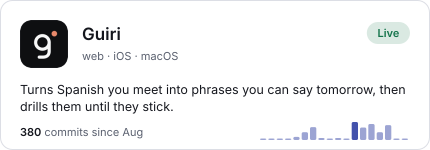</picture></a>
<a href="https://inadviser.com"><picture><source media="(prefers-color-scheme: dark)" srcset="https://raw.githubusercontent.com/zaitsew/zaitsew/main/assets/cards/inadviser-dark.svg">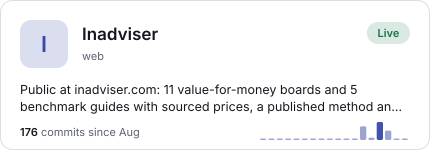</picture></a>
<a href="https://apps.apple.com/app/id6809226188?ct=github-profile&mt=8"><picture><source media="(prefers-color-scheme: dark)" srcset="https://raw.githubusercontent.com/zaitsew/zaitsew/main/assets/cards/loco-dark.svg">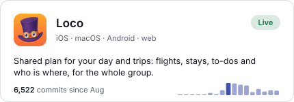</picture></a>
<a href="https://teyla.dev"><picture><source media="(prefers-color-scheme: dark)" srcset="https://raw.githubusercontent.com/zaitsew/zaitsew/main/assets/cards/teyla-dark.svg">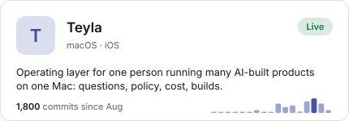</picture></a>
<a href="https://apps.apple.com/app/id6808361269?ct=github-profile&mt=8"><picture><source media="(prefers-color-scheme: dark)" srcset="https://raw.githubusercontent.com/zaitsew/zaitsew/main/assets/cards/wine-cave-dark.svg">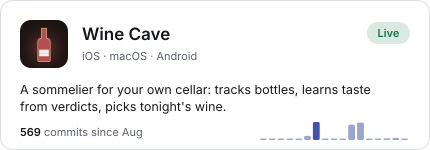</picture></a>

### Beta · 8

<picture><source media="(prefers-color-scheme: dark)" srcset="https://raw.githubusercontent.com/zaitsew/zaitsew/main/assets/cards/afterglow-dark.svg">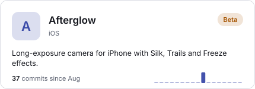</picture>
<a href="https://github.com/zaitsew/casa-no-pasa"><picture><source media="(prefers-color-scheme: dark)" srcset="https://raw.githubusercontent.com/zaitsew/zaitsew/main/assets/cards/casa-no-pasa-dark.svg">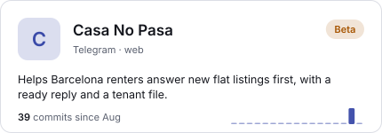</picture></a>
<picture><source media="(prefers-color-scheme: dark)" srcset="https://raw.githubusercontent.com/zaitsew/zaitsew/main/assets/cards/finca-dark.svg">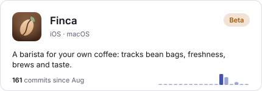</picture>
<picture><source media="(prefers-color-scheme: dark)" srcset="https://raw.githubusercontent.com/zaitsew/zaitsew/main/assets/cards/iron-u-dark.svg">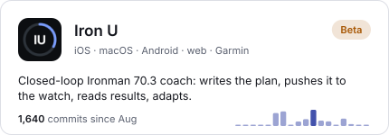</picture>
<picture><source media="(prefers-color-scheme: dark)" srcset="https://raw.githubusercontent.com/zaitsew/zaitsew/main/assets/cards/lumi-dark.svg">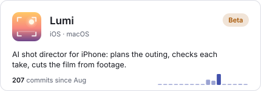</picture>
<picture><source media="(prefers-color-scheme: dark)" srcset="https://raw.githubusercontent.com/zaitsew/zaitsew/main/assets/cards/orbita-dark.svg">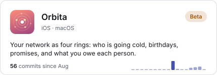</picture>
<picture><source media="(prefers-color-scheme: dark)" srcset="https://raw.githubusercontent.com/zaitsew/zaitsew/main/assets/cards/petit-chef-dark.svg">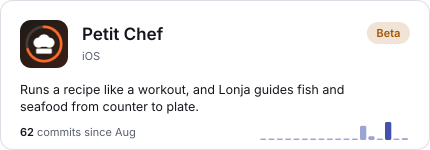</picture>
<a href="https://github.com/zaitsew/speedyt"><picture><source media="(prefers-color-scheme: dark)" srcset="https://raw.githubusercontent.com/zaitsew/zaitsew/main/assets/cards/speedyt-dark.svg">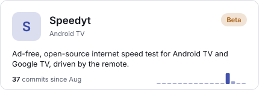</picture></a>

### Building · 13

<picture><source media="(prefers-color-scheme: dark)" srcset="https://raw.githubusercontent.com/zaitsew/zaitsew/main/assets/cards/aufwind-dark.svg">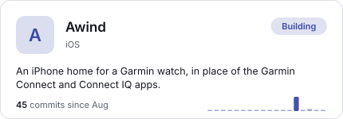</picture>
<a href="https://github.com/zaitsew/baika"><picture><source media="(prefers-color-scheme: dark)" srcset="https://raw.githubusercontent.com/zaitsew/zaitsew/main/assets/cards/baika-dark.svg">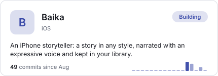</picture></a>
<a href="https://github.com/zaitsew/bankjar"><picture><source media="(prefers-color-scheme: dark)" srcset="https://raw.githubusercontent.com/zaitsew/zaitsew/main/assets/cards/bankjar-dark.svg">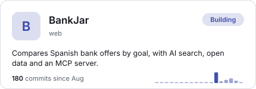</picture></a>
<picture><source media="(prefers-color-scheme: dark)" srcset="https://raw.githubusercontent.com/zaitsew/zaitsew/main/assets/cards/beyond-intelligence-dark.svg">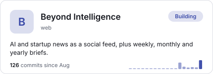</picture>
<a href="https://github.com/zaitsew/casavpn"><picture><source media="(prefers-color-scheme: dark)" srcset="https://raw.githubusercontent.com/zaitsew/zaitsew/main/assets/cards/casavpn-dark.svg">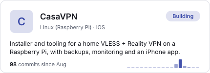</picture></a>
<a href="https://github.com/zaitsew/dremo"><picture><source media="(prefers-color-scheme: dark)" srcset="https://raw.githubusercontent.com/zaitsew/zaitsew/main/assets/cards/dremo-dark.svg">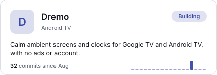</picture></a>
<a href="https://github.com/zaitsew/filmare"><picture><source media="(prefers-color-scheme: dark)" srcset="https://raw.githubusercontent.com/zaitsew/zaitsew/main/assets/cards/filmare-dark.svg">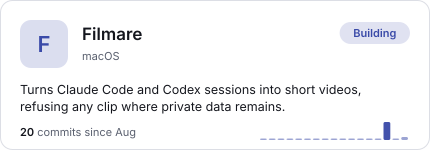</picture></a>
<a href="https://github.com/zaitsew/finance-k"><picture><source media="(prefers-color-scheme: dark)" srcset="https://raw.githubusercontent.com/zaitsew/zaitsew/main/assets/cards/finance-k-dark.svg">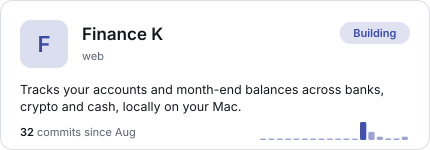</picture></a>
<a href="https://github.com/zaitsew/qupa"><picture><source media="(prefers-color-scheme: dark)" srcset="https://raw.githubusercontent.com/zaitsew/zaitsew/main/assets/cards/qupa-dark.svg">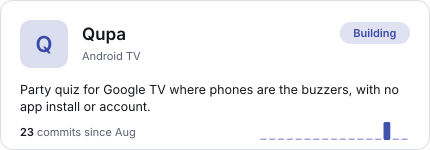</picture></a>
<a href="https://github.com/zaitsew/rumbo"><picture><source media="(prefers-color-scheme: dark)" srcset="https://raw.githubusercontent.com/zaitsew/zaitsew/main/assets/cards/rumbo-dark.svg">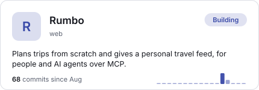</picture></a>
<a href="https://github.com/zaitsew/sawk"><picture><source media="(prefers-color-scheme: dark)" srcset="https://raw.githubusercontent.com/zaitsew/zaitsew/main/assets/cards/sawk-dark.svg">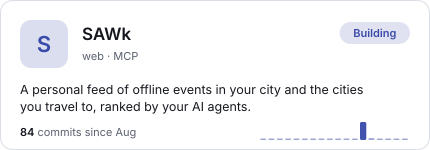</picture></a>
<a href="https://github.com/zaitsew/serendip"><picture><source media="(prefers-color-scheme: dark)" srcset="https://raw.githubusercontent.com/zaitsew/zaitsew/main/assets/cards/serendip-dark.svg">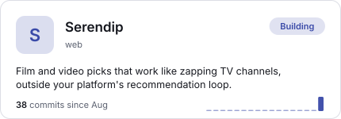</picture></a>
<a href="https://github.com/zaitsew/vago"><picture><source media="(prefers-color-scheme: dark)" srcset="https://raw.githubusercontent.com/zaitsew/zaitsew/main/assets/cards/vago-dark.svg">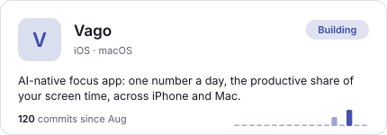</picture></a>

## How I build

<picture><source media="(prefers-color-scheme: dark)" srcset="https://raw.githubusercontent.com/zaitsew/zaitsew/main/assets/build-dark.svg">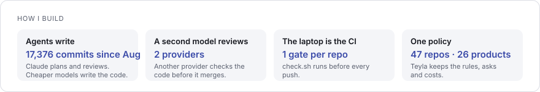</picture>

The rules, open questions and costs for all of it live in [Teyla](https://github.com/zaitsew/teyla), which is open source.

Generated from my tools catalog, so it lists what ships today, not what is planned.
